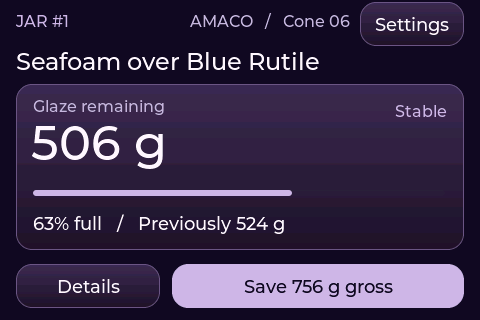
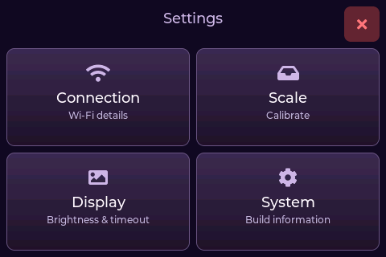
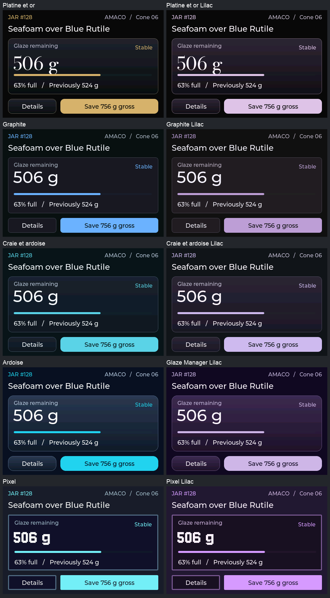

# Glaze Scale

ESPHome touchscreen scale for Glaze Manager. The simulator and WT32-SC01 Plus
firmware share the **Glaze Manager Lilac** theme (option 4, purple Ardoise),
including its Montserrat type, gradient panels, and 480×320 layout.

## Desktop simulator

On macOS install Xcode Command Line Tools, SDL2 (`brew install sdl2`), and the
ESPHome CLI version pinned in `requirements.txt`. Use `brew install esphome` if
it offers that version, or install the pin into a Python virtual environment.
Linux requires a C++ compiler, Git, Make, the SDL2 development package, and the
same CLI. The initial build downloads dependencies.

Run `uv sync --locked` in the sibling `glaze-manager` checkout, then run
`make sim` here. It opens the studio UI and starts the real Manager API on a
loopback port using a temporary database. Each launch starts with fresh jars.
For another checkout, set `GLAZE_MANAGER_DIR` and, if needed, `MANAGER_PYTHON`.

| Key | Studio simulator action |
| --- | --- |
| **1** | Place known jar #1 at 756 g gross |
| **2** | Place a new tag at 600 g gross |
| **3** | Place jar #1 at 224 g, below its 250 g tare |
| **0** | Remove the jar and tag |
| **4 / 5** | Simulate NFC initialization failure / read failure |
| **↑ / ↓** | Add or remove 10 g, including on an untagged platform |
| **F12** | Capture the current screen |

Keep screen regions at fixed heights as the scale changes state. The main
screen reserves space for jar identity, weight, stock level, and feedback so
each appears in the same place during selection, weighing, saving, and removal.

**Tare** commits the platform zero to flash once the reading settles. **Save**
requires a settled weight and a selected jar. Choose a jar in the dropdown or
place a jar with a known NFC tag on the scale to select it automatically. You
can choose a jar before placing it on the platform. After you lift it off, the
manual selection clears when the gross weight settles at zero. An unknown tag shows **Unlinked jar** on the weighing screen.
Open its dropdown to link an untagged jar or choose **New jar...**. Choose a
glaze, optionally select a container preset, enter a location or tap a matching
suggestion, and enter the cost in USD. **Create** links the tag and
records the first reading. **New glaze...** opens glaze creation.
**Save** and **New jar → Create** share one pending request in flash. You can lift
the jar or restart the scale while it awaits confirmation. The scale retries
the original jar and weight with the same request ID. The large number stays
live, and the status line shows the weight being saved. Another save becomes
available once Manager confirms or rejects the pending one. A changed jar
requires review before a new submission.

The selected jar’s number appears beside the glaze name. The status bar shows
Glaze Manager, NFC, and Wi-Fi from left to right, followed by Settings. Each
warning expands beside its icon. The inventory icon is dim while the scale
cannot verify the service and stays yellow after a failed request until a retry
or another inventory request succeeds. Tap a yellow **Unavailable** warning to act
on it. Wi-Fi opens the network picker and starts a scan. The inventory warning
offers **Retry**, which checks whether the scale can read jars from Glaze Manager.
Tap the gear to open **Settings** from the weighing screen. The red **×** returns to weighing.

| Tile | Controls |
| --- | --- |
| **Connection** | Pick a nearby Wi-Fi network, enter its password, and tap **Connect**. The password is visible as you type and the field clears when you connect or cancel. **Scan now** refreshes the list. The simulator offers **Workshop** with password `studio`. |
| **Scale** | Calibrate with an empty platform and a known reference mass. In the simulator, press **0**, capture the empty platform, press **↑** ten times, wait a second, and enter **100** grams. |
| **Display** | Adjust brightness from 10–100% and choose a screen-off delay of 30 seconds or 1, 2, 5, or 10 minutes. Defaults are 100% and 2 minutes. Both settings persist across restarts. |
| **System** | View the current IP address, Glaze Scale software version, and ESPHome version. The scale version comes from `git describe --tags --always --dirty` at build time. |

A tap wakes the screen and leaves the underlying control untouched. A detected
NFC tag or a stable increase of at least 3 g on the calibrated scale also wakes
it. A stationary load can time out. The physical scale turns off its backlight;
the simulator dims or blanks its own window.

`make test-studio` runs the UI headlessly and checks the resulting inventory,
including a lost save receipt, a repeated tap, a setup conflict and a fresh
confirmation. `make scaffold` runs the original neutral touch demo.

## Theme review

Run `make themes` to compare five LVGL themes and their purple variants.
Press **P** to toggle the current theme between original and lilac on the same
screen. The gallery opens on **Glaze Manager Lilac**. **T** cycles through
all ten palettes.
The window title and terminal show the current palette.

Press **1** for a stable jar, **2** for below tare, or **3** for the new-jar
keyboard. Click the keyboard to edit the location. The fixtures are local and
all save actions are demonstrations.

The [five purple variants across three views](docs/lilac-theme-views.png)
show the selection in row four. Compare the same pairs with a [below-tare warning](docs/theme-comparison-warning.png)
or the [new-jar keyboard](docs/theme-comparison-form.png).

**F12** captures the current 480×320 screen. Run `make previews` to export all
30 captures without a desktop. Each run prints a fresh output directory.
`make test-touch` checks the scaffold's initial label and sends SDL mouse
press and release events through the ESPHome touchscreen driver.

Each purple variant uses the typography, gradient treatment, and control shapes
of its original. **Glaze Manager Lilac** is the Ardoise variant. The five
original palettes are adapted from [Axellum's Tab5 themes](https://github.com/Axellum/M5-Tab5-ESPHome-LVGL/tree/9bb801e780e10f9f37e4800cc09a2c2e1ee2af3f/Tab5/themes).
The palette license and the Bodoni Moda and Jersey 10 font licenses are in `ui/`.

## Studio firmware

Copy `secrets.example.yaml` to `secrets.yaml` and set the HTTPS origin,
Cloudflare Access service-token pair, local OTA password, fallback hotspot
password, and default Wi-Fi credentials. Run `make firmware` to build or `esphome run scale.yaml --device
<USB-port>` to install over USB. For subsequent local OTA installs supply
the device IP. `make check-firmware` cross-compiles the same target with a
reserved test hostname and example credentials.

On first boot the scale tries `wifi_ssid` from your ESPHome secrets.
At the studio, open **Settings → Connection**, select the network, and enter
its password. ESPHome remembers that selection across ordinary restarts.
A firmware update that changes the ESPHome configuration hash or version can
return the scale to the configured network. After 90 seconds without a
connection, the scale offers its password-protected `glaze-scale` hotspot.

**Settings → Scale** captures the
empty platform, then asks for a steady reference mass in grams. Once the scale
shows **Calibration saved**, you can unplug it immediately. The 2 kg cell needs physical
qualification: check zero and known masses across its range, repeat after a
power cycle, and verify readings to ±1 g before studio use.

## Hardware bench

`make bench` builds a USB bench image for the WT32-SC01 Plus with the same
touch target as the scaffold. Serial logs show detected PN532 UIDs and raw
NAU7802 values. Raw ADC values are uncalibrated. With the kit connected, use
`esphome run bench.yaml --device <USB-port>` and test touch at the center of
the button. Verify landscape orientation, I²C devices, increasing load, and
tag placement and removal on the actual assembly.

The build targets the 16 MB, quad-PSRAM Plus board and separate I²C buses for
touch and the external scale peripherals. Check the board marking and wire
by signal using the [SpoolmanScale wiring guide](https://niko11111.github.io/SpoolmanScale-Docs/build/wiring/).
Remote service access is described in [Operations](docs/operations.md).

## Releases

Publish a GitHub Release from a tag such as `v1.0.0` or `v1.0.0-rc.1`. Mark a
release candidate as a prerelease. Use GitHub’s generated notes to summarize
the changes since the previous tag, including hardware checks and any change
to the compatible Glaze Manager version.

The release workflow repeats the simulator tests and builds both the bench
and studio firmware. It attaches the tested `glaze-scale-<tag>.tar.gz` and
`SHA256SUMS` to the release. Download both and run `shasum -a 256 -c SHA256SUMS`
before extracting. The archive includes its tag for Settings → System when
building outside Git. Build the studio image locally with your own
`secrets.yaml`. The bench target can be built and flashed directly over USB.

## License

Glaze Scale is licensed under [Apache 2.0](LICENSE). The adapted palettes
retain their [MIT license](ui/palette-LICENSE.txt). Bodoni Moda and Jersey 10
retain their respective [Bodoni Moda](ui/fonts/BodoniModa-LICENSE.txt) and
[Jersey 10](ui/fonts/Jersey10-LICENSE.txt) font licenses.
